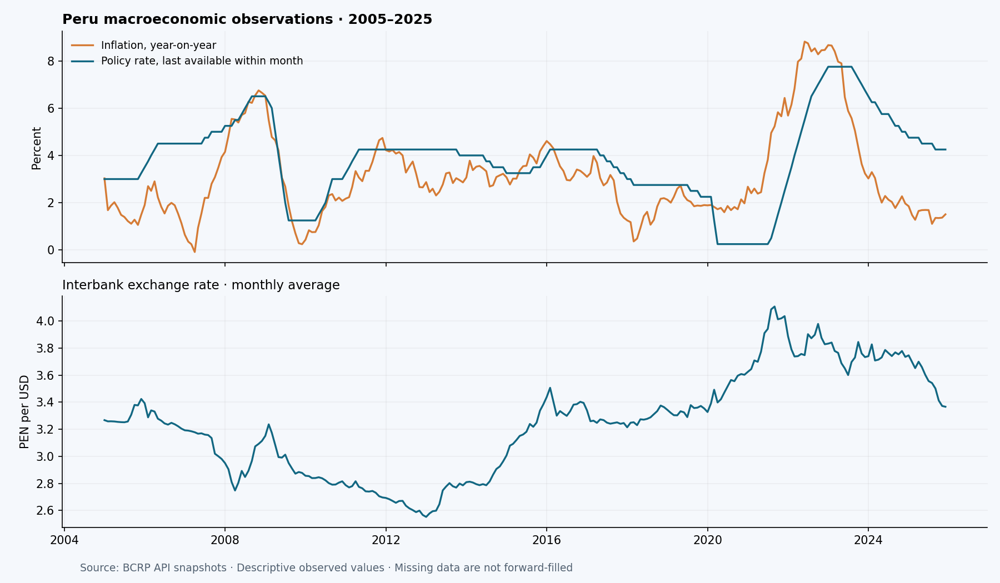

<div align="center">

# Peru Macro Data Platform

**A revision-aware data platform for Peru's macroeconomic indicators.**

BCRP API · Python · PostgreSQL · SCD Type 2 · dbt · Tested publication

[](https://github.com/NeilBorjasRamos/peru-macro-data-platform/actions/workflows/ci.yml)

[Español](README.es.md) · [Architecture](docs/ARCHITECTURE.md) · [Data contract](docs/DATA_CONTRACT.md) · [Validation](docs/VALIDATION.md) · [Walkthrough](docs/GUIA_COMPLETA.md)

</div>

## The engineering problem

A current economic value is not necessarily the value your system saw yesterday.
Source data can change, contain missing values, or arrive at different frequencies.
Loading an API response into a table does not solve those problems.

This platform captures **eight BCRP series**, preserves exact source snapshots,
tracks observation revisions in PostgreSQL, aligns daily and monthly frequencies,
and publishes analytics only after an isolated dbt build passes its tests.

**Author:** [Neil Borjas Ramos](https://github.com/NeilBorjasRamos)

## What makes this a step beyond a batch ETL

| Concern | Implemented solution | Evidence |
|---|---|---|
| Revised observations | SCD2 history keyed by series and source period | Revision and as-of regression tests |
| Replay | Unchanged values do not create history versions | Real replay added zero versions |
| Mixed frequencies | Preserve daily source periods; monthly last available non-null policy rate | Exact-period SQL and contract tests |
| Invalid source values | Immutable Bronze, per-run quarantine, per-series 1% gate | One malformed daily observation isolated in real capture |
| Failed analytical build | Build in a unique schema; atomically swap consumer views after tests | Promotion rollback test |
| Writer concurrency | PostgreSQL session advisory lock covers the orchestrator | Passed against PostgreSQL 16.6 in GitHub Actions |
| Testable ingestion | CLI, typed observation contract and separated persistence | 44 tests passed locally with the limitation below |
| Safe demonstration | Real and synthetic modes cannot share a database | Mode isolation regression test |

This is not a larger row-count exercise: the harder work is **temporal correctness,
frequency semantics and safe publication**.

## Observed real-data results

Capture range: **2005-01-01 to 2025-12-31**.

| Result | Observed |
|---|---:|
| Configured series | 8 |
| Source observations | 7,242 |
| Accepted source keys | 7,241 |
| Explicit missing values among accepted rows | 106 |
| Malformed numeric observations quarantined | 1 |
| Monthly dashboard rows | 252 |
| New history versions on identical replay | 0 |
| dbt models built / data tests passed | 4 / 12 |



The local database validation used **PGlite, a WebAssembly PostgreSQL build**.
Local Python validation: **44 passed, 1 concurrency test skipped, 87% statement
coverage**. Remote CI subsequently ran against **PostgreSQL 16.6: all 45 Python tests
passed**, including independent-session writer locking. The synthetic end-to-end
demo also passed all 12 dbt tests.
[Verified CI run](https://github.com/NeilBorjasRamos/peru-macro-data-platform/actions/runs/40123384269). [Full evidence and limits](docs/VALIDATION.md).

## Source catalog

| Code | Indicator | Frequency | Unit |
|---|---|---|---|
| PN38705PM | Lima CPI | Monthly | Index, December 2021 = 100 |
| PN01271PM | Lima inflation | Monthly | Monthly percentage change |
| PN01273PM | Lima inflation | Monthly | Twelve-month percentage change |
| PN01207PM | Interbank exchange rate | Monthly | PEN per USD, period average |
| PN01770AM | GDP | Monthly | Index, 2007 = 100 |
| PN01652XM | Copper LME | Monthly | US cents per pound |
| PN01654XM | Gold LME | Monthly | USD per troy ounce |
| PD12301MD | Policy reference rate | Daily | Percent |

Series descriptions and units were checked against the official BCRP catalog.
The old example CPI index series PN01270PM is discontinued; this project uses
PN38705PM instead. No credential is needed for the public data API.

## Run the synthetic demonstration

Requirements: Docker Engine/Desktop with Compose.
The .env.example values are **public disposable local-development credentials**.

```bash
cp .env.example .env
docker compose -p macro-demo up -d postgres
docker compose -p macro-demo run --rm runner demo
docker compose -p macro-demo run --rm runner demo --revised
docker compose -p macro-demo run --rm runner status
```

The revised demo changes one GDP observation. It is explicitly synthetic.
The database refuses to mix real and synthetic modes.

## Run a real historical load

Use a separate Compose project so the volumes and database are isolated:

```bash
docker compose -p macro-real up -d postgres
docker compose -p macro-real run --rm runner sync \
  --start 2005-01-01 --end 2025-12-31
docker compose -p macro-real run --rm runner status
```

Both Compose projects map their PostgreSQL service to host port 5433. Stop the
demo service before starting the real one:
`docker compose -p macro-demo stop postgres`.
Do not delete a volume just to switch datasets.

Docker and Compose are provided but were not executed in the authoring environment.
The local SQL/dbt evidence above used PGlite; see validation before inferring
platform compatibility.

## Python development

Python 3.12 is the validated interpreter. The package permits Python 3.11–3.13;
other versions remain unvalidated. Use uv 0.13.4 or a compatible newer version.

```bash
uv sync --frozen --extra dev
uv run --frozen pytest -q
uv run --frozen ruff check src tests scripts
uv run --frozen ruff format --check src tests scripts
```

Without TEST_DATABASE_URL, database tests explicitly skip.
For the real pipeline, start PostgreSQL, export DATABASE_URL and run from this
repository root:

```bash
# macOS / Linux / Git Bash: load your local development settings.
set -a
source .env
set +a

uv run --frozen macro sync --start 2005-01-01 --end 2025-12-31
uv run --frozen macro status
```

PowerShell environment and detailed setup:
[Spanish walkthrough](docs/GUIA_COMPLETA.md).
The dbt project is a repository resource; run from the root or pass --dbt-project.
It is copied into the Docker image rather than bundled inside the Python wheel.

## Architecture and publication boundary

```mermaid
flowchart TD
  A["BCRP API: daily and monthly"] --> B["Bronze: exact bytes + SHA-256"]
  B --> C["Contract, missing markers and quality gate"]
  C --> D["PostgreSQL SCD2 observation history"]
  C --> E["Per-run rejected observations"]
  D --> F["Isolated dbt build schema"]
  F --> G["dbt data tests"]
  G --> H["Atomic consumer-view promotion"]
```



Ingestion commits history, source provenance and counts in one transaction.
dbt then materializes immutable candidate tables in a unique schema. Consumer
views are changed together only after dbt succeeds.

**These are two publication boundaries, not one cross-process transaction.**
If dbt fails, newly ingested history remains available while consumers retain
the previous tested analytics snapshot. [Read the ADR](docs/adr/002-publication.md).

## Query current analytics and observed history

```sql
select month, inflation_yoy_pct, exchange_pen_usd,
       policy_rate_eom_pct, gdp_yoy_pct
from macro_analytics.mart_macro_dashboard
order by month desc;

select code, period, value, valid_from, valid_to
from macro_raw.observation_history
where code = 'PN01770AM'
order by period, valid_from;
```

As-of query:
```bash
uv run --frozen macro as-of --at 2026-10-24T18:00:00+00:00
```

Use an instant taken from your run log to reproduce an actual observation state.
The initial load does **not** reconstruct BCRP's historical release vintages.
History begins when this system observes the data. This distinction prevents
misleading point-in-time claims.

The policy-minus-inflation column is a descriptive percentage-point difference,
not an ex-ante real interest rate or an investment recommendation.

## Documentation

| Document | Purpose |
|---|---|
| [Architecture](docs/ARCHITECTURE.md) | Components, state transitions, storage and isolation |
| [Data contract](docs/DATA_CONTRACT.md) | Source grain, date parsing, missingness and gates |
| [Walkthrough](docs/GUIA_COMPLETA.md) | Installation and phased implementation in Spanish |
| [Runbook](docs/RUNBOOK.md) | Recovery, backfill, revision lookback and retention |
| [Validation](docs/VALIDATION.md) | Measured results, engine scope and pending checks |
| [ADRs](docs/adr/) | Temporal and publication decisions |
| [Roadmap](docs/ROADMAP.md) | Explicitly unimplemented enhancements |
| [Contributing](CONTRIBUTING.md) | Development and safe integration testing |

## Scope and limitations

No historical official vintages, automatic deletion detection, scheduler, hosted
dashboard, authentication service or cloud deployment is claimed. Source metadata
uses the current checked-in catalog; metadata itself is not SCD2. A failed or
missing update does not erase a previously accepted observation. Rejected values
are never silently split or repaired.

Each successful run retains its candidate schema. Retention cleanup is manual
and must preserve the active publication. Schema version 1 initializes the data
model; automatic future migrations are not implemented. See the runbook.

## Attribution and license

Data: [BCRPData](https://estadisticas.bcrp.gob.pe/estadisticas/series/ayuda/api),
with original providers identified in its series catalog.
Code: [MIT](LICENSE). Dataset rights and conditions remain with their providers.
The repository includes aggregate evidence, code and docs; no raw source dumps,
database files, private credentials or runtime logs are committed.
